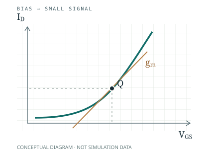

::: {.archive-home}
::: {.home-intro}
::: {.intro-copy}
[PERSONAL STUDY & TEXTBOOK]{.eyebrow}

# Analog IC Design

[소자에서 회로로, 이해한 것을 한 장씩.]{.home-lead}

아날로그 집적회로 설계를 공부하고, 개념과 설계 과정을 교재로 정리하는 공간입니다.
계산의 가정부터 시뮬레이션 조건, 다시 확인할 질문까지 연결해 기록합니다.

::: {.home-actions}
[교재 읽기 →](textbook/index.qmd){.primary-link}
[학습 노트](notes/index.qmd){.secondary-link}
:::
:::

::: {.intro-figure}
{.circuit-figure fig-alt="동작점과 소신호 기울기의 개념도"}
:::
:::

::: {.home-rule}
[01]{.section-index} [TEXTBOOK]{.eyebrow}
:::

## 한 장씩 만드는 교재

소자의 동작점을 출발점으로, 증폭기와 아날로그 회로의 설계까지 이어갈 교재입니다.
현재는 첫 장의 **작성 예시 초안**을 담았습니다. 이후의 장은 공부하면서 채워갈 예정입니다.

::: {.chapter-entry}
::: {.chapter-number}
01
:::
::: {.chapter-copy}
### [동작점에서 시작하기](textbook/01-operating-point.qmd)

바이어스, 트랜스컨덕턴스, 그리고 $g_m/I_D$. 수식과 간단한 계산으로 읽는 첫 장.

[소자와 동작점]{.topic-label} [작성 예시]{.draft-label}
:::
::: {.chapter-arrow aria-hidden="true"}
↗
:::
:::

::: {.home-bottom}
::: {.home-note}
[02 / STUDY NOTES]{.eyebrow}

### 공부의 과정도 남기기

교재에 정리하기 전의 질문과 실험, 시뮬레이션 조건을 기록합니다.
아직 개인 학습 기록은 등록되지 않았습니다.

[학습 노트로 →](notes/index.qmd)
:::

::: {.home-note}
[03 / REFERENCES]{.eyebrow}

### 출처와 생각을 함께

읽은 자료의 출처를 남기고, 직접 이해한 설명과 구분해서 정리합니다.

[참고자료 보기 →](references.qmd)
:::
:::
:::
